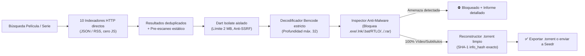

# Torrent Seeder

**Buscador Torrent autónomo para Películas y Series de TV con Sandbox antivirus integrado y soporte multi-cuenta Seedr.cc**

*100 % autónomo en Android, Windows y Linux — Sin servidor, sin publicidad, sin navegadores peligrosos.*

[🇫🇷 Français](README.md) | [🇬🇧 English](README.en.md) | **🇪🇸 Español**

---

## 🎯 ¿Por qué Torrent Seeder?

Buscar archivos `.torrent` en la web suele exponer a los usuarios a dos riesgos principales: **páginas llenas de anuncios maliciosos** (popups, falsos botones «Download», scripts peligrosos) y **torrents falsos** que ocultan ejecutables (`Pelicula.mkv.exe`, accesos directos `.lnk`, archivos `.rar` con contraseña).

**Torrent Seeder** elimina ambos riesgos mediante una arquitectura **100 % local y autónoma**:

- **Sin servidor externo**: el APK de Android funciona de forma totalmente independiente en tu teléfono, igual que las aplicaciones de Windows y Linux.
- **Sin WebView / sin navegador**: las búsquedas se realizan únicamente mediante peticiones HTTP directas (APIs JSON / RSS XML / metadatos).
- **Sandbox integrado**: cada `.torrent` se descarga en memoria dentro de un **Isolate de Dart aislado**, se inspecciona archivo por archivo y se **reconstruye limpio** sin metadatos externos antes de guardarlo o enviarlo a Seedr.

---

## 📦 Descarga

Descarga directamente la última versión lista para usar desde [**GitHub Releases**](https://github.com/furcy75/Torrent-Finder/releases/latest):

| Plataforma | Archivo | Instalación |
| :--- | :--- | :--- |
| **Android** *(autónomo)* | [`TorrentSeeder-Android.apk`](https://github.com/furcy75/Torrent-Finder/releases/latest/download/TorrentSeeder-Android.apk) | Instalar el APK directamente en el teléfono |
| **Windows** *(Instalador)* | [`TorrentSeeder-Windows-Setup.exe`](https://github.com/furcy75/Torrent-Finder/releases/latest/download/TorrentSeeder-Windows-Setup.exe) | Doble clic (DLLs de Visual C++ incluidas, sin requisitos) |
| **Windows** *(Portable)* | [`TorrentSeeder-Windows-Portable.zip`](https://github.com/furcy75/Torrent-Finder/releases/latest/download/TorrentSeeder-Windows-Portable.zip) | Descomprimir y ejecutar `safetorrent.exe` |
| **Linux** *(Ubuntu / Debian / Mint)* | [`TorrentSeeder-Linux-amd64.deb`](https://github.com/furcy75/Torrent-Finder/releases/latest/download/TorrentSeeder-Linux-amd64.deb) | `sudo apt install ./TorrentSeeder-Linux-amd64.deb` |
| **Linux** *(Portable)* | [`TorrentSeeder-Linux-x64.tar.gz`](https://github.com/furcy75/Torrent-Finder/releases/latest/download/TorrentSeeder-Linux-x64.tar.gz) | Descomprimir y ejecutar `./safetorrent` |

---

## ✨ Funciones principales

### 🎬 Búsqueda guiada de Películas y Series de TV
1. **Entrada limpia**: selecciona **Películas** o **Series de TV** y escribe solo el título.
2. **Identificación multilingüe**: consulta simultáneamente **AlloCiné**, **Wikidata (FR / EN / ES)**, **TVMaze** e **IMDb**, mostrando la **portada** y los títulos en cada idioma con **banderas vectoriales a color**.
3. **Seguimiento de Series de TV**: muestra el **número de temporadas**, el **estado**, la **fecha de estreno de la próxima temporada o episodio** y un selector rápido de temporada (`S01`, `S02`..., `Completa`).
4. **Nueva búsqueda** en un clic para empezar de cero.

### 🏷️ Filtros rápidos por categoría y Visor NFO seguro
- **Filtros organizados por filas**:
  - **Idiomas**: Français, English, Español, MULTI *(con banderas vectoriales)*
  - **Disponibilidad**: `▲ Seeders activos`, `🔥 ≥ 10 seeders`
  - **Tamaño máx.**: `< 2 GB`, `< 5 GB`, `< 10 GB`
  - **Resolución**: `4K`, `1080p`, `720p`
  - **Fuente y Códec**: `BluRay`, `WEB-DL`, `WEBRip`, `HDRip`, `H.264 / x264`, `x265`, `HDR`
  - **Calidad**: `🚫 Sin CAM/TS` *(activado por defecto)*
- **Visor NFO / Detalles**: muestra la información NFO/MediaInfo en texto plano monoespaciado sin ejecutar jamás HTML ni JavaScript.

### ☁️ Integración Seedr.cc en vivo (multi-cuenta y avisos discretos)
- **Múltiples cuentas Seedr**: conecta varias cuentas con nombre mediante **Código de Dispositivo** (`seedr.cc/devices`, renovación automática sin guardar contraseña) o **Email y Contraseña** (solo se guarda el token OAuth localmente, nunca la contraseña).
- **Selector manual con cuota y estado en tiempo real**: al enviar un enlace Magnet o un `.torrent` limpio desde el Sandbox, **Torrent Seeder** comprueba en vivo el espacio libre de cada cuenta e indica si ya hay una **descarga en curso**, dejando que **elijas manualmente** la cuenta de destino.
- **Aviso discreto de descarga completada**: una ventana emergente sobria (**«Archivo descargado»**, sin mostrar el nombre ni detalles del archivo) te avisa automáticamente al terminar una transferencia en Seedr.
- **Gestión completa en vivo**: cambia de cuenta, revisa tu cuota, sigue las descargas activas, navega por carpetas/archivos, abre descargas directas HTTPS, crea ZIP de carpetas, copia enlaces directos (VLC) y elimina elementos en un clic.

### 📌 Lista «Más tarde» (sin historial innecesario)
- No guarda ningún historial de búsquedas innecesario.
- Guarda películas pendientes o series esperando nueva temporada conservando su **portada**, títulos multilingües y la **fecha de la próxima temporada** (con botón para actualizar la fecha).

---

## 🛡️ Arquitectura del Sandbox

---

## 🔎 Fuentes integradas (10 + Torznab opcional)

Todas las fuentes se pueden activar o desactivar individualmente en **⚙️ Ajustes**:
**YTS**, **APIBay**, **Knaben**, **TorrentCSV**, **SolidTorrents**, **EZTV**, **BitSearch**, **Nyaa**, **LimeTorrents**, **Internet Archive** y **Torznab** (compatible con **Jackett** y **Prowlarr**).

---

## 💖 Apoyar el proyecto

**Torrent Seeder** es gratuito, de código abierto y sin publicidad. Si te resulta útil, puedes apoyar su desarrollo a través de [**GitHub Sponsors**](https://github.com/sponsors/furcy75) (también accesible desde el icono dedicado de donación dentro de la aplicación).

---

## ⚖️ Aviso legal y Licencia

Torrent Seeder es una herramienta técnica para buscar y verificar metadatos BitTorrent (`.torrent`). La aplicación no aloja ningún contenido protegido. Cada usuario es el único responsable del uso que haga del software y del cumplimiento de las leyes de derechos de autor de su país.

Distribuido bajo licencia **MIT** — consulta [LICENSE](LICENSE).
