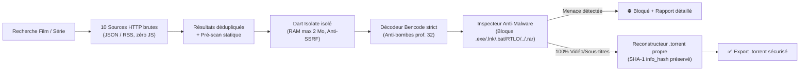

<div align="center">


# SafeTorrent

**Moteur de recherche Torrent autonome pour Films & Séries TV avec bac à sable anti-virus intégré**

*100 % autonome sur Android, Windows et Linux — Zéro serveur, zéro infrastructure, zéro publicité, zéro navigateur piégé.*

[](https://github.com/furcy75/Torrent-Finder/actions/workflows/build-release.yml)
[](https://github.com/furcy75/Torrent-Finder/releases/latest)
[](#téléchargement)
[](LICENSE)

</div>

---

## 🎯 Pourquoi SafeTorrent ?

Chercher un fichier `.torrent` sur le web expose habituellement à deux menaces majeures : les **pages web publicitaires piégées** (popups, faux boutons « Download », scripts malveillants) et les **faux torrents** contenant des exécutables déguisés (`Film.mkv.exe`, raccourcis `.lnk`, archives `.rar` piégées).

**SafeTorrent** élimine ces deux risques grâce à une architecture **100 % locale et autonome** :

- **Aucun serveur requis** : l'APK Android tourne en totale autonomie sur votre téléphone, tout comme l'application Windows et Linux.
- **Aucune WebView / aucun navigateur** : les recherches s'effectuent exclusivement via des requêtes HTTP brutes (APIs JSON / RSS XML / métadonnées).
- **Bac à sable intégré** : chaque `.torrent` est téléchargé en mémoire dans un **Isolate Dart séparé**, inspecté fichier par fichier, puis **reconstruit à neuf** sans métadonnées externes avant d'être enregistré.

---

## 📦 Téléchargement

Récupérez directement la dernière version prête à l'emploi depuis [**GitHub Releases**](https://github.com/furcy75/Torrent-Finder/releases/latest) :

| Plateforme | Fichier | Installation |
| :--- | :--- | :--- |
| **Android** *(autonome)* | [`SafeTorrent-Android.apk`](https://github.com/furcy75/Torrent-Finder/releases/latest/download/SafeTorrent-Android.apk) | Installer l'APK directement sur le téléphone |
| **Windows** *(Installateur)* | [`SafeTorrent-Windows-Setup.exe`](https://github.com/furcy75/Torrent-Finder/releases/latest/download/SafeTorrent-Windows-Setup.exe) | Double-clic (DLLs Visual C++ incluses, zéro prérequis) |
| **Windows** *(Portable)* | [`SafeTorrent-Windows-Portable.zip`](https://github.com/furcy75/Torrent-Finder/releases/latest/download/SafeTorrent-Windows-Portable.zip) | Décompresser et lancer `safetorrent.exe` |
| **Linux** *(Ubuntu / Debian / Mint)* | [`SafeTorrent-Linux-amd64.deb`](https://github.com/furcy75/Torrent-Finder/releases/latest/download/SafeTorrent-Linux-amd64.deb) | `sudo apt install ./SafeTorrent-Linux-amd64.deb` |
| **Linux** *(Portable)* | [`SafeTorrent-Linux-x64.tar.gz`](https://github.com/furcy75/Torrent-Finder/releases/latest/download/SafeTorrent-Linux-x64.tar.gz) | Décompresser et lancer `./safetorrent` |

---

## ✨ Fonctionnalités principales

### 🎬 Parcours guidé Films & Séries TV
1. **Saisie ultra-simple** : choisissez **Films** ou **Séries TV** et tapez uniquement le titre.
2. **Identification multilingue** : recherche simultanée sur **AlloCiné**, **Wikidata (FR / EN / ES)**, **TVMaze** et **IMDb** affichant la **vignette (affiche)** et les titres dans chaque langue avec de **vrais drapeaux vectoriels en couleur**.
3. **Suivi des Séries TV** : affichage du **nombre de saisons**, du **statut** (*En cours*, *Terminée*...), de la **date de sortie de la prochaine saison ou du prochain épisode**, et d'un sélecteur rapide par saison (`S01`, `S02`..., `Intégrale`).
4. **Nouvelle recherche** en un clic pour repartir à zéro.

### 🏷️ Filtres rapides par catégories & Détails NFO
- **Filtres organisés en lignes** :
  - **Langues** : Français, English, Español, MULTI *(avec drapeaux vectoriels)*
  - **Disponibilité** : `▲ Seeders actifs`, `🔥 ≥ 10 seeders`
  - **Taille max** : `< 2 Go`, `< 5 Go`, `< 10 Go`
  - **Résolution** : `4K`, `1080p`, `720p`
  - **Source & Codec** : `BluRay`, `WEB-DL`, `WEBRip`, `HDRip`, `H.264 / x264`, `x265`, `HDR`
  - **Qualité** : `🚫 Sans CAM/TS` *(activé par défaut)*
- **Visionneuse NFO / Détails sécurisée** : consulte le NFO/MediaInfo en texte brut monospace (APIBay `t.php`, fiche YTS, `.nfo` Internet Archive) sans jamais rendre de HTML ou JavaScript.

### 📌 Liste « Plus tard » (sans historique superflu)
- Aucun historique de navigation inutile n'est enregistré.
- Sauvegardez en un clic les films non trouvés ou les séries en attente d'une nouvelle saison dans **Plus tard** : leur **vignette**, leurs titres multilingues et la **date de sortie de la saison suivante** sont conservés (avec bouton **Actualiser date**).

---

## 🛡️ Architecture du Bac à Sable



### Protections actives dans le bac à sable
| Menace | Protection implémentée |
| :--- | :--- |
| **Malvertising, popups, drive-by downloads** | Zéro WebView, zéro navigateur, zéro exécution JavaScript |
| **Exécutables & scripts cachés** | Blocage strict : `.exe`, `.msi`, `.bat`, `.cmd`, `.scr`, `.lnk`, `.vbs`, `.ps1`, `.js`, `.apk`, `.dmg`, `.iso`, doubles extensions `.mkv.exe` |
| **Usurpation d'extension Unicode (RTLO)** | Détection et blocage des caractères bidirectionnels (`\u202e`, etc.) |
| **Traversée de répertoire (`../`)** | Validation stricte de chaque segment de chemin (`..`, `/`, `\`, `C:`) |
| **Faux films en archive piégée** | Blocage configurable des `.zip`, `.rar`, `.7z` et mode vidéo strict |
| **Bombes Bencode / pages HTML déguisées** | Plafond strict `2 Mo`, profondeur max `32`, rejet immédiat `text/html` |
| **Attaques SSRF** | Validation DNS + IP sur chaque requête et redirection (blocage `file://`, `127.0.0.1`, réseaux privés) |
| **Métadonnées externes / trackers suspects** | Reconstruction d'un `.torrent` minimal (`announce`, `announce-list`, `info` brut bit-exact) |

---

## 🔎 Sources intégrées (10 + Torznab)

Toutes les sources sont activables/désactivables individuellement dans **⚙️ Réglages** :

| Source | Protocole | Contenu | Spécificité |
| :--- | :--- | :--- | :--- |
| **YTS** | API JSON | Films HD / 4K | Liens `.torrent` directs + fiche technique |
| **APIBay** | API JSON | Films & Séries | NFO / MediaInfo complet via `t.php` |
| **Knaben** | API JSON | Films & Séries | Agrégateur multi-trackers (1337x, TGx, TPB, RuTracker...) |
| **TorrentCSV** | API JSON | Films & Séries | Base open-source rapide |
| **SolidTorrents** | API JSON | Films & Séries | Catalogue vidéo indexé par seeders |
| **EZTV** | HTML brut | Séries TV | Spécialiste séries avec `.torrent` directs |
| **BitSearch** | HTML brut | Films & Séries | Méta-index haute couverture |
| **Nyaa** | RSS XML | Anime & Animation | Liens `.torrent` directs |
| **LimeTorrents** | RSS XML | Films & Séries | Liens `.torrent` directs |
| **Internet Archive** | API JSON | Classiques / Domaine public | `.torrent` et `.nfo` directs |
| **Torznab *(optionnel)*** | XML standard | Vos propres trackers | Compatible **Jackett** & **Prowlarr** |

---

## 🛠️ Développement & Compilation locale

Prérequis : [Flutter 3.24+](https://docs.flutter.dev/get-started/install) (Dart 3.3+) et Python 3 + Pillow *(pour générer les icônes natives)*.

```bash
# 1. Cloner le dépôt
git clone https://github.com/furcy75/Torrent-Finder.git
cd Torrent-Finder

# 2. Générer les runners plateformes & les icônes
flutter create --platforms=android,windows,linux --org com.safetorrent --project-name safetorrent .
python3 installer/generate_icons.py --platform android   # ou windows / linux
flutter pub get

# 3. Lancer l'analyse statique et les tests sécurité/UI
flutter analyze
flutter test -r expanded

# 4. Compiler au choix
flutter build apk --release        # Android APK
flutter build windows --release    # Windows x64
flutter build linux --release      # Linux x64
```

### Structure du dépôt
```text
├── assets/icon/app_icon.png          # Icône maître 1024x1024
├── installer/
│   ├── generate_icons.py             # Génération icônes Android/Windows/Linux
│   ├── windows_setup.iss             # Script installateur Inno Setup (.exe)
│   └── build_deb.sh                  # Empaquetage Debian/Ubuntu (.deb)
├── lib/
│   ├── models/                       # Modèles Film/Série, Torrent, SafetyReport, Watchlist
│   ├── sandbox/                      # Bencode strict, Anti-Malware Sanitizer, Isolate Worker
│   ├── services/                     # AlloCiné/TVMaze/Wikidata, 10 Indexeurs, NFO, Stockage local
│   └── ui/                           # Interface Material 3, CountryFlag vectoriel, modales
├── test/                             # Tests unitaires Bencode, Sécurité/SSRF, Parser, Stockage, UI
└── .github/workflows/build-release.yml
```

---

## ⚖️ Avertissement légal & Licence

SafeTorrent est un outil technique de recherche et d'assainissement de métadonnées BitTorrent (`.torrent`). L'application n'héberge aucun contenu protégé. Chaque utilisateur est seul responsable de l'usage qu'il en fait et du respect de la législation sur le droit d'auteur en vigueur dans son pays.

Distribué sous licence **MIT** — voir [LICENSE](LICENSE).
