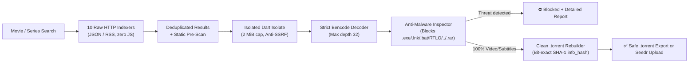

<div align="center">


# Torrent Seeder

**Standalone Movie & TV Series Torrent Search Engine with Built-in Anti-Malware Sandbox & Multi-Account Seedr.cc Integration**

*100% standalone on Android, Windows, and Linux — Zero server, zero ads, zero trapped browsers, 6-language UI.*

**🇬🇧 English** | [🇫🇷 Français](README.fr.md) | [🇪🇸 Español](README.es.md) | [🇩🇪 Deutsch](README.de.md) | [🇳🇱 Nederlands](README.nl.md) | [🇮🇹 Italiano](README.it.md)

[](https://github.com/furcy75/Torrent-Finder/actions/workflows/build-release.yml)
[](https://github.com/furcy75/Torrent-Finder/releases/latest)
[](#download)
[](https://github.com/sponsors/furcy75)
[](LICENSE)

</div>

---

## 🎯 Why Torrent Seeder?

Searching for `.torrent` files on the web typically exposes users to two major risks: **malicious ad-filled web pages** (popups, fake "Download" buttons, drive-by scripts) and **fake torrents** hiding executables (`Movie.mkv.exe`, `.lnk` shortcuts, password-protected `.rar` traps).

**Torrent Seeder** eliminates both threats with a **100% local, standalone architecture**:

- **No server required**: the Android APK runs completely solo on your phone, just like the Windows and Linux apps.
- **No WebView / no browser engine**: searches use raw HTTP requests only (JSON APIs / RSS XML / metadata).
- **Built-in Anti-Malware Sandbox**: every `.torrent` file is downloaded in memory inside an **isolated Dart Isolate**, inspected file-by-file, and **rebuilt cleanly** without external metadata before saving or sending to Seedr.
- **Instant 6-Language UI**: switch live between **English, Français, Español, Deutsch, Nederlands, and Italiano** via the flag icon next to Settings.

---

## 📦 Download

Grab the latest ready-to-use binaries from [**GitHub Releases**](https://github.com/furcy75/Torrent-Finder/releases/latest):

| Platform | File | Installation |
| :--- | :--- | :--- |
| **Android** *(standalone)* | [`TorrentSeeder-Android.apk`](https://github.com/furcy75/Torrent-Finder/releases/latest/download/TorrentSeeder-Android.apk) | Install the APK directly on your device |
| **Windows** *(Installer)* | [`TorrentSeeder-Windows-Setup.exe`](https://github.com/furcy75/Torrent-Finder/releases/latest/download/TorrentSeeder-Windows-Setup.exe) | Double-click (Visual C++ DLLs bundled, zero prerequisites) |
| **Windows** *(Portable)* | [`TorrentSeeder-Windows-Portable.zip`](https://github.com/furcy75/Torrent-Finder/releases/latest/download/TorrentSeeder-Windows-Portable.zip) | Extract and launch `safetorrent.exe` |
| **Linux** *(Ubuntu / Debian / Mint)* | [`TorrentSeeder-Linux-amd64.deb`](https://github.com/furcy75/Torrent-Finder/releases/latest/download/TorrentSeeder-Linux-amd64.deb) | `sudo apt install ./TorrentSeeder-Linux-amd64.deb` |
| **Linux** *(Portable)* | [`TorrentSeeder-Linux-x64.tar.gz`](https://github.com/furcy75/Torrent-Finder/releases/latest/download/TorrentSeeder-Linux-x64.tar.gz) | Extract and run `./safetorrent` |

---

## ✨ Key Features

### 🎬 Guided Movie & TV Series Workflow
1. **Clean Title Input**: toggle **Movies** or **TV Series** and enter only the title.
2. **Multilingual Matching**: simultaneously queries **AlloCiné**, **Wikidata**, **TVMaze**, and **IMDb**, displaying the **poster thumbnail** and localized titles with **vector country flags**.
3. **TV Series Tracking**: displays **season count**, **status**, **next season / next episode release date**, and a quick season selector (`S01`, `S02`..., `Complete`).
4. **One-Click Reset** to start a fresh search from scratch.

### 🏷️ Categorized Quick Filters & Secure NFO Viewer
- **Row-grouped quick filters**:
  - **Languages**: French, English, Spanish, German, Dutch, Italian, MULTI *(with vector flags)*
  - **Availability**: `▲ Active seeders`, `🔥 ≥ 10 seeders`
  - **Max size**: `< 2 GB`, `< 5 GB`, `< 10 GB`
  - **Resolution**: `4K`, `1080p`, `720p`
  - **Source & Codec**: `BluRay`, `WEB-DL`, `WEBRip`, `HDRip`, `H.264 / x264`, `x265`, `HDR`
  - **Quality**: `🚫 Exclude CAM/TS` *(enabled by default)*
- **Plain-text NFO / Details Viewer**: displays NFO/MediaInfo safely in monospace text with zero HTML/JS execution.

### ☁️ Live Seedr.cc Integration (Multi-Account & Discreet Alerts)
- **Multiple Seedr Accounts**: connect multiple named accounts via **Device Code OAuth** (`seedr.cc/devices`, auto-refreshing with zero password stored) or **Email & Password** (only the OAuth token is saved locally — passwords are never stored).
- **Quota & Active Transfer Picker**: before sending a Magnet link or sanitized `.torrent` file, **Torrent Seeder** checks each account's live free space and indicates whether a **download is currently in progress**, letting you **manually choose** which account to use.
- **Discreet Download Complete Popup**: displays a clean privacy-friendly alert (**"File downloaded"**, without revealing any filename or details) as soon as a Seedr transfer finishes.
- **Live Account Management**: switch accounts, view storage quota, monitor active transfers, browse folders/files, open direct HTTPS downloads, download folder ZIPs, copy direct URLs (VLC), and delete items in one tap.

### 📌 Watchlist (No Cluttered History)
- No unnecessary search history is stored.
- Save unfound movies or upcoming TV series with their **poster**, multilingual titles, and **next season release date** (with a one-click date refresh button).

---

## 🛡️ Sandbox Architecture



---

## 🔎 Built-in Indexers (10 + Optional Torznab)

All sources can be toggled individually in **⚙️ Settings**:
**YTS**, **APIBay** (with NFO), **Knaben**, **TorrentCSV**, **SolidTorrents**, **EZTV**, **BitSearch**, **Nyaa**, **LimeTorrents**, **Internet Archive**, plus optional **Torznab** (**Jackett** & **Prowlarr**).

---

## 💖 Support the Project

**Torrent Seeder** is 100% free, open-source, and ad-free. If you enjoy using it, you can support ongoing development through [**GitHub Sponsors**](https://github.com/sponsors/furcy75) (also accessible via the dedicated donate icon inside the app).

[](https://github.com/sponsors/furcy75)

---

## 🛠️ Local Development & Build

Requirements: [Flutter 3.24+](https://docs.flutter.dev/get-started/install) (Dart 3.3+) and Python 3 + Pillow *(to generate platform icons)*.

```bash
git clone https://github.com/furcy75/Torrent-Finder.git
cd Torrent-Finder

flutter create --platforms=android,windows,linux --org com.safetorrent --project-name safetorrent .
python3 installer/generate_icons.py --platform android   # or windows / linux
flutter pub get

flutter analyze
flutter test -r expanded

flutter build apk --release        # Android APK
flutter build windows --release    # Windows x64
flutter build linux --release      # Linux x64
```

---

## ⚖️ Legal Notice & License

Torrent Seeder is a technical tool for searching and sanitizing BitTorrent metadata (`.torrent`). The application hosts no copyrighted material. Users are solely responsible for how they use this software and for complying with applicable copyright laws in their jurisdiction.

Licensed under the **MIT License** — see [LICENSE](LICENSE).
